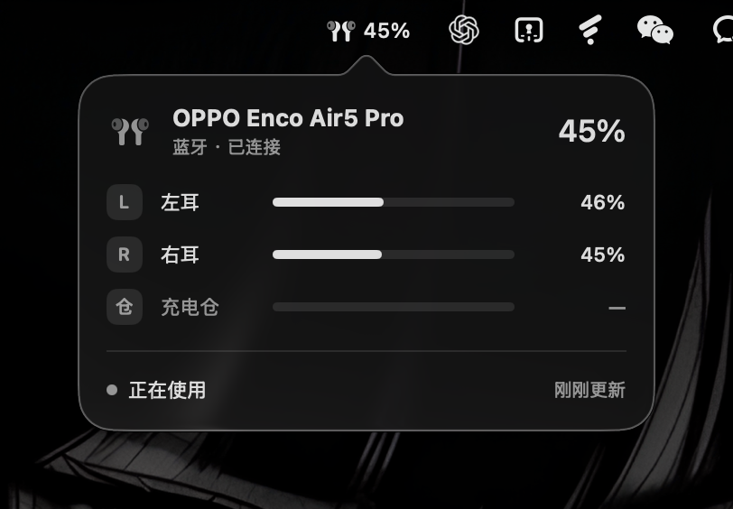

# EncoBattery

**macOS 菜单栏显示 OPPO Enco Air5 Pro 的左右耳 + 充电仓电量。**

系统蓝牙只给你一个笼统的「100%」，分不清左耳右耳、更看不到充电仓。这个小工具走耳机自己的控制通道（OPPO 私有 SPP 协议），直接向耳机查询三路电量，30 秒刷新一次。

[](https://github.com/coderlife-book/oppo-enco-battery)
[](https://github.com/coderlife-book/oppo-enco-battery/releases/latest)
[](LICENSE)
[](https://github.com/coderlife-book/oppo-enco-battery/releases/latest)


## 截图

下面是真实运行时的桌面截图（耳机放在充电仓里，左右耳和仓都在充电）。

|  | 浅色模式 | 深色模式 |
| --- | --- | --- |
| 耳机在仓里：左右耳 + 仓都在充电 |  |  |
| 耳机戴在耳朵上：只有左右耳 |  |  |

左键点菜单栏图标弹出卡片，右键是「刷新电量 / 退出 EncoBattery」。菜单栏只显示一个数字（取左右耳里较低的那只），低于 20% 变橙、低于 10% 变红；耳机没连接时图标置灰、不显示数字。

## 安装

**给朋友（双击安装）**：下载 [Releases](https://github.com/coderlife-book/oppo-enco-battery/releases/latest) 里的 `EncoBattery-1.0.0.dmg` → 双击打开 → 把 `EncoBattery.app` 拖进「应用程序」→ 首次打开被 Gatekeeper 拦下时，右键「打开」再点「打开」，或到「系统设置 → 隐私与安全性」点「仍要打开」。

> 没有 $99/年的 Apple 开发者证书，所以是 ad-hoc 签名、未公证，第一次必须手动放行一次。仅此一次。

**自己编译**：

```bash
./build.sh            # 通用二进制（Apple Silicon + Intel），产出 EncoBattery.app
open EncoBattery.app
./make_dmg.sh         # 需要分发包时：dist/EncoBattery-1.0.0.dmg
```

要求 macOS 13+，耳机需要先在这台 Mac 上配对并连接过。

## 支持的设备

**已验证**：OPPO Enco Air5 Pro（产品 id `0x06C410`，主控 物奇 WUQI WQ7035AX-B）。

协议是 OPPO/realme/OnePlus 共用的 BBK「OPOv1」私有 SPP，同一套服务 UUID 和帧格式被 HeyMelody（欢律）、Gadgetbridge、PairFree 等使用，所以同家族的 realme Buds / OnePlus Nord Buds 等很可能也能用——但我手上只有 Air5 Pro，其他型号未验证。想试的话把 `EB_DEBUG=1` 的日志发我。

## 环境变量

| 变量 | 作用 |
| --- | --- |
| `EB_ADDRESS` | 手动指定设备地址，如 `aa-bb-cc-dd-ee-ff`；默认按名字（OPPO / Enco / realme / OnePlus）在已配对设备里找 |
| `EB_INTERVAL` | 轮询间隔秒数，默认 `30` |
| `EB_DEBUG` | 打印每一帧收发内容 |
| `EB_SHOWCARD` | 启动 N 秒后自动弹出卡片（截图用） |
| `EB_APPEARANCE` | `dark` / `light`，强制外观（截图用） |
| `EB_FAKE` | `charging` / `empty` / `offline`，注入假数据看外观 |
| `EB_RENDER` | 离屏渲染一张卡片 PNG 到指定路径后退出（截图用，不需要屏幕） |
| `EB_SHOT` | 离屏渲染「菜单栏图标 + 三角 + 弹窗」整张合成图，配合 `EB_APPEARANCE` / `EB_FAKE` |

## 常见问题

**第一次刷新要 3 秒，之后很快？** 正常。进程内第一次 `openRFCOMMChannelSync` 必定 3.1 秒超时返回 `kIOReturnError`——RFCOMM mux 的建立被算进这一次调用里；紧接着重试就成功（100～200ms）。代码里因此带「预热 + 最多 3 次重试」。

**看不到充电仓？** 仓的电量只有在耳机放回仓里时才会作为第 3 项上报。

**打开后菜单栏没出现？** 大概率是蓝牙权限还没给：重新打开 app，允许「EncoBattery 想要使用蓝牙」。每次重新编译（签名变了）macOS 都会重新问一次。

**iPhone 上连着欢律会影响吗？** 不影响。实测手机蓝牙开着、耳机与 iPhone 双连接时，Mac 照样读到左右耳电量。

**会不会偷偷读别的蓝牙设备？** 不会。只碰名字匹配 OPPO / Enco / realme / OnePlus 的已配对设备，只发查询指令，不改任何设置，不联网。

## 原理

<details>
<summary>协议细节（逆向所得，只读）</summary>

经典蓝牙 SPP，RFCOMM **channel 5**，服务 UUID `0000079A-D102-11E1-9B23-00025B00A5A5`（OPPO 私有服务，SDP 里名字叫 `COM7`，与 HeyMelody 用的是同一条通道）。

帧格式（OPOv1）：

```
AA <len> 00 00 <cmd LE16> <seq> <paylen LE16> <payload>     len = 帧总长 - 2
```

- `0x0106` 查电量 → 回 `0x8106`：`status(0) + count + count × (设备字节, 电量字节)`
  - 设备字节：`1` = 左耳，`2` = 右耳，`3` = 充电仓
  - 电量字节低 7 位是百分比，bit7 是「充电中」
- `0x0103` 查产品 id → 回 `0x8103`，Enco Air5 Pro = `0x06C410`

实测回包：

```
tx aa 07 00 00 06 01 02 00 00
rx aa 0d 00 00 06 81 02 06 00 00 02 01 64 02 64   → 左 100% 右 100%（戴着，仓不报）

rx aa 0f 00 00 06 81 03 08 00 00 03 01 e4 02 e4 03 5a
   → 左 0xE4 = 100% + 充电中，右 0xE4 = 100% + 充电中，仓 0x5A = 90%
```

顺带一提：耳机还会主动推 `0x0204` 广播帧（JSON，含佩戴侧、硬件错误计数、已配对设备列表），本工具忽略。

</details>

## English

**Menu bar battery indicator for OPPO Enco Air5 Pro earbuds on macOS — left, right and charging case.**

macOS reports a single aggregate battery level for Bluetooth earbuds. This tiny menu bar app talks to the earbuds over their own private SPP/RFCOMM channel (the same one HeyMelody uses) and asks for the three battery levels separately, refreshing every 30 seconds.

Download `EncoBattery-1.0.0.dmg` from [Releases](https://github.com/coderlife-book/oppo-enco-battery/releases/latest), drag the app to *Applications*, then right-click → *Open* the first time (ad-hoc signed, not notarized — Gatekeeper will require one manual approval).

Keywords: OPPO Enco Air5 Pro battery on macOS, earbuds menu bar battery, charging case battery level, HeyMelody alternative for Mac, realme / OnePlus TWS battery, reverse-engineered OPPO SPP protocol. Requires macOS 13+, universal binary (Apple Silicon + Intel).

## License

[MIT](LICENSE) © 2026 bookbook

> 本项目与 OPPO / realme / OnePlus 无关，协议信息来自对公开流量的观察与社区逆向成果。
