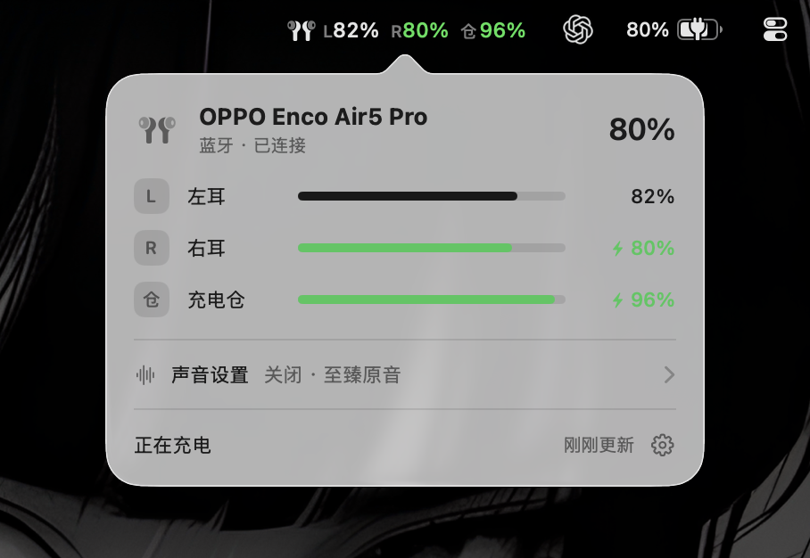
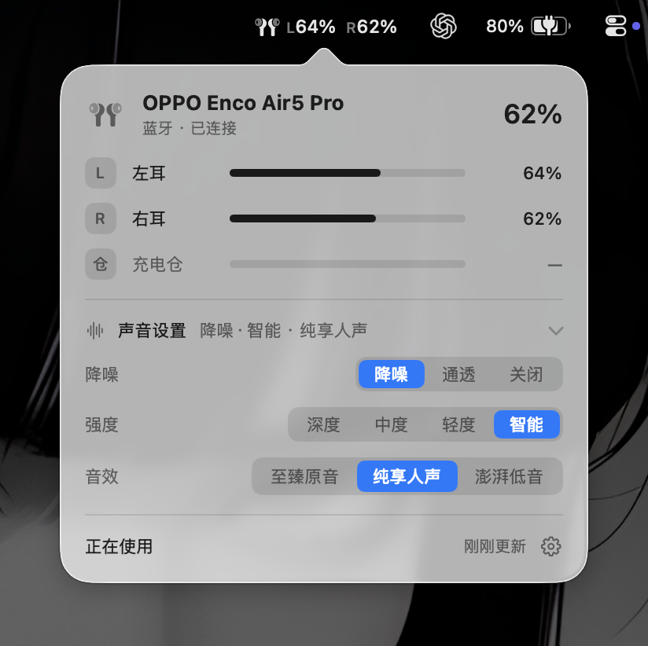
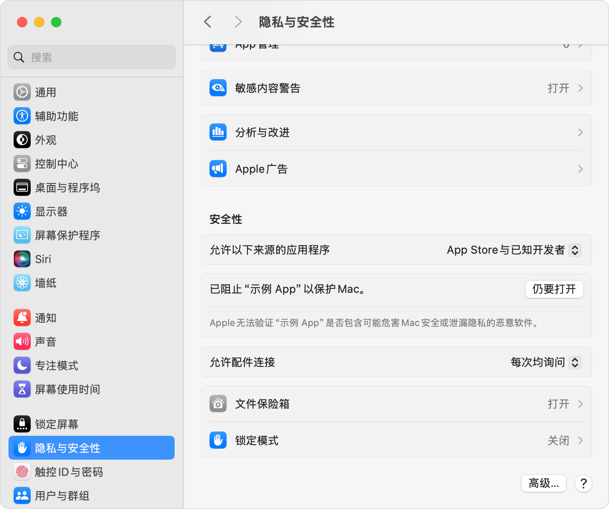

# OPPO Enco Air5 Pro for Mac

在 macOS 菜单栏查看左右耳和充电仓电量，切换降噪、通透和音效。设置中可选择显示哪些电量，并查看固件版本。

[下载最新版 DMG](https://github.com/coderlife-book/oppo-enco-air5-pro-for-mac/releases/latest) · macOS 13+ · Apple Silicon / Intel

## 截图

| 外观 | 电量概览 | 声音设置 | 设置窗口 |
| --- | :---: | :---: | :---: |
| 浅色 |  |  |  |
| 深色 |  |  |  |

## 安装

1. 打开下载的 DMG，把 `EncoBattery.app` 拖入「应用程序」。升级前先退出旧版。
2. 尝试打开应用。安装包未经 Apple 公证。若提示 Apple 无法验证应用，先点击「完成」，确认从本仓库下载后再前往「系统设置 → 隐私与安全性 → 安全性」，点击「仍要打开」。
3. 再次出现提示时，点击「打开」确认。配对并连接耳机后，点击菜单栏的耳机图标。切换降噪时请佩戴耳机。



参考 [Apple 支持 · 在 Mac 上安全地打开 App](https://support.apple.com/zh-cn/102445)。

## 从源码构建

需要 Xcode Command Line Tools。

```bash
./build.sh
open EncoBattery.app
```

[MIT 许可证](LICENSE) · OPPO Enco Air5 Pro 的独立社区项目。
