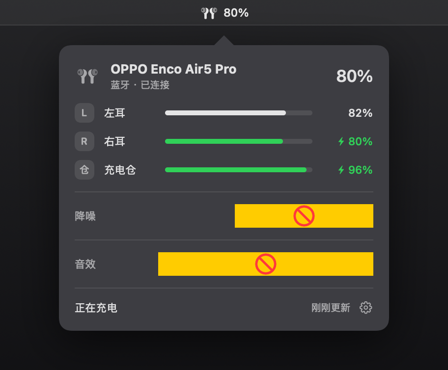

# EncoBattery

macOS 菜单栏上看 OPPO Enco Air5 Pro 的左右耳和充电仓电量。

系统蓝牙只给一个总电量。这个 app 直接问耳机要：左耳、右耳、充电仓，分开显示，30 秒刷新一次。

[](https://github.com/coderlife-book/oppo-enco-battery)
[](https://github.com/coderlife-book/oppo-enco-battery/releases/latest)
[](LICENSE)
[](https://github.com/coderlife-book/oppo-enco-battery/releases/latest)


## 怎么用

左键点菜单栏图标弹出卡片，右键是「刷新电量」和「退出」。

菜单栏只放一个数字，取左右耳里低的那只。20% 以下变橙，10% 以下变红。耳机没连上就是灰色图标，不显示数字。

## 安装

去 [Releases](https://github.com/coderlife-book/oppo-enco-battery/releases/latest) 下载 `EncoBattery-1.1.0.dmg`，打开，把 `EncoBattery.app` 拖进「应用程序」。

第一次启动会被 Gatekeeper 拦住。右键点 app →「打开」→ 再点一次「打开」，或者去「系统设置 → 隐私与安全性」点「仍要打开」。只需要放行一次。

app 是 ad-hoc 签名，没有 Apple 开发者证书，所以没做公证。

需要 macOS 13 或更新。耳机得先在这台 Mac 上配对、连接过。

自己编译：

```bash
./build.sh        # 通用二进制，产出 EncoBattery.app
open EncoBattery.app
./make_dmg.sh     # 需要分发包时
```

## 截图

两套都是真实运行时的截屏。上排耳机在仓里，左右耳和仓都在充电；下排耳机戴着，只有左右耳。

| 浅色 | 深色 |
| --- | --- |
|  |  |
|  |  |

## 支持的设备

已验证 OPPO Enco Air5 Pro。产品 id `0x06C410`，主控是物奇的 WQ7035AX-B。

走的是 BBK 的 OPOv1 私有协议，HeyMelody（欢律）、Gadgetbridge、PairFree 用的是同一条。realme、OnePlus 同家族大概率也能读，但我没有那些耳机，没验证过。想试就把 `EB_DEBUG=1` 的输出发我。

## 环境变量

| 变量 | 作用 |
| --- | --- |
| `EB_ADDRESS` | 手动指定设备地址，如 `aa-bb-cc-dd-ee-ff`。默认按名字在已配对设备里找 |
| `EB_INTERVAL` | 刷新间隔秒数，默认 `30` |
| `EB_DEBUG` | 打印每一帧收发内容 |
| `EB_FAKE` | `charging` / `empty` / `offline`，塞假数据看效果 |
| `EB_SHOWCARD` | 启动 N 秒后自动弹出卡片 |
| `EB_APPEARANCE` | `dark` / `light`，强制外观 |
| `EB_RENDER` | 离屏渲染一张卡片 PNG 后退出，不需要屏幕 |
| `EB_SHOT` | 离屏渲染整张「菜单栏 + 卡片」合成图 |

## 常见问题

**第一次刷新要等 3 秒？** 正常。进程里第一次开 RFCOMM 通道必定超时，3.1 秒返回 `kIOReturnError`，因为多路复用的建立被算在这一个调用里。紧接着重试就通了，100～200ms。代码里做了预热和重试。

**看不到充电仓？** 仓只在耳机放回去的时候才报，戴着的时候没有这一项。

**打开后菜单栏没东西？** 蓝牙权限没给。重新打开 app，点「允许」。每次重新编译签名都会变，macOS 会再问一遍。

**iPhone 上还开着欢律，会冲突吗？** 不会。手机蓝牙开着、耳机和手机双连的时候，Mac 照样读得到。

**会读别的蓝牙设备吗？** 只碰名字里带 OPPO / Enco / realme / OnePlus 的已配对设备。只发查询，不改设置，不联网。

## 原理

<details>
<summary>协议细节</summary>

经典蓝牙 SPP，RFCOMM **channel 5**，服务 UUID `0000079A-D102-11E1-9B23-00025B00A5A5`。这是 OPPO 的私有服务，SDP 里名字叫 `COM7`，和 HeyMelody 用的是同一条。

帧格式（OPOv1）：

```
AA <len> 00 00 <cmd LE16> <seq> <paylen LE16> <payload>     len = 帧总长 - 2
```

`0x0106` 查电量，回 `0x8106`：`status(0) + count + count × (设备字节, 电量字节)`。

- 设备字节：`1` 左耳，`2` 右耳，`3` 充电仓
- 电量字节低 7 位是百分比，bit7 表示充电中

`0x0103` 查产品 id，回 `0x8103`，Enco Air5 Pro 是 `0x06C410`。

实测回包：

```
tx aa 07 00 00 06 01 02 00 00
rx aa 0d 00 00 06 81 02 06 00 00 02 01 64 02 64   → 左 100%，右 100%（戴着，仓不报）

rx aa 0f 00 00 06 81 03 08 00 00 03 01 e4 02 e4 03 5a
   → 左 0xE4 = 100% 充电中，右 0xE4 = 100% 充电中，仓 0x5A = 90%
```

耳机还会主动推 `0x0204` 广播帧，里面是 JSON，有佩戴侧、硬件错误计数、已配对设备列表。这个工具不处理。

</details>

## English

Menu bar battery for OPPO Enco Air5 Pro earbuds on macOS: left, right and charging case, read over the earbuds' own private SPP channel.

macOS reports one aggregate number for Bluetooth earbuds. This app asks the earbuds directly, every 30 seconds, and shows what comes back.

Grab `EncoBattery-1.1.0.dmg` from [Releases](https://github.com/coderlife-book/oppo-enco-battery/releases/latest), drag it into *Applications*, then right-click → *Open* the first time. It is ad-hoc signed and not notarized, so Gatekeeper asks once. macOS 13+, universal binary.

Same protocol as HeyMelody, Gadgetbridge and PairFree. Only Enco Air5 Pro is tested; realme and OnePlus earbuds from the same family may work.

## License

[MIT](LICENSE) © 2026 bookbook

不是 OPPO / realme / OnePlus 的官方项目。协议信息来自公开流量观察和社区逆向成果。
