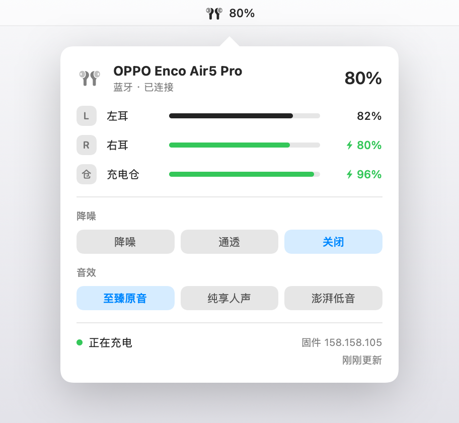
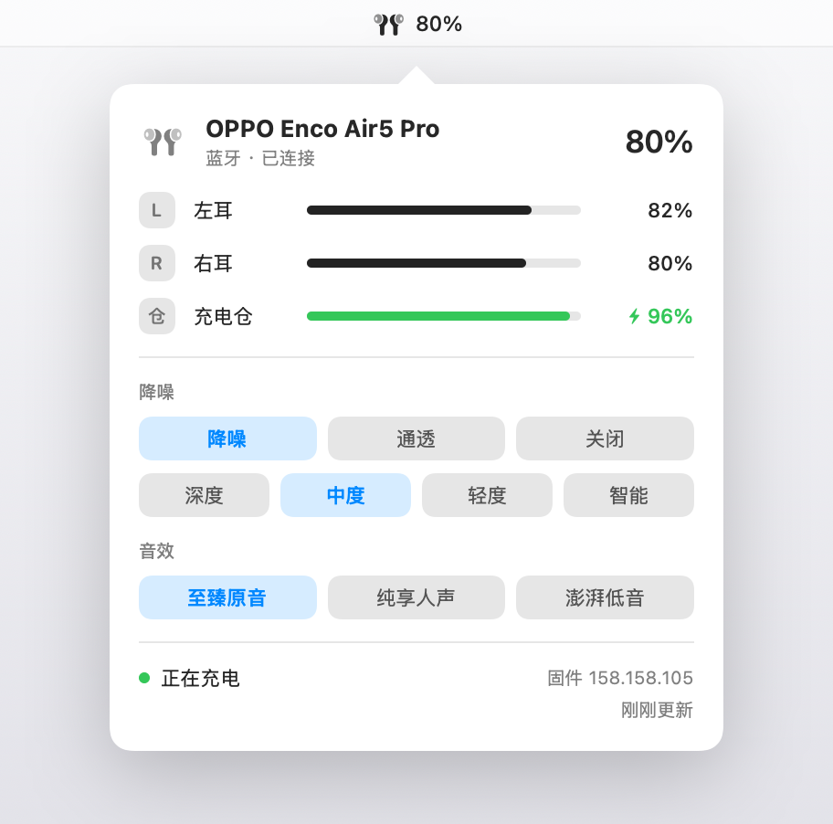

# EncoBattery

macOS 菜单栏上的 OPPO Enco Air5 Pro 小助手：左右耳、充电仓电量，降噪切换，音效切换，固件版本。

系统蓝牙只给一个总电量。这个 app 直接问耳机要：左耳、右耳、充电仓，分开显示。降噪和音效也走同一条通道，点了就生效，手机上的欢律会跟着变，反过来也一样。

[](https://github.com/coderlife-book/oppo-enco-battery)
[](https://github.com/coderlife-book/oppo-enco-battery/releases/latest)
[](LICENSE)
[](https://github.com/coderlife-book/oppo-enco-battery/releases/latest)



## 怎么用

左键点菜单栏图标弹出卡片：

- 三行电量，充电中的带小闪电。菜单栏数字取左右耳里低的那只，20% 以下变橙，10% 以下变红。
- **降噪**：降噪 / 关闭 / 通透。选降噪后多出一排强度：深度 / 中度 / 轻度 / 智能。
- **音效**：至臻原音 / 澎湃低音 / 纯享人声。
- 底部一行小字：连接状态和固件版本。

降噪、音效跟着耳机走：手机欢律里改了，卡片几秒内跟上；在卡片里点了，手机上也变。和欢律看的是同一个状态，两边不会打架。

右键菜单：刷新、重连耳机、退出。

一个已知限制：降噪模式是耳机主动回报的，卡片第一次打开时可能还没拿到，切换一次（或手机上动一下）就会显示。

## 降噪要戴着耳机

耳机在充电盒里或者没在佩戴时，会拒绝降噪切换，卡片会提示「耳机拒绝了降噪设置」。戴上再点就好。音效切换不受这个限制，盒里也能改。

## 安装

去 [Releases](https://github.com/coderlife-book/oppo-enco-battery/releases/latest) 下载 `EncoBattery-2.0.0.dmg`，打开，把 `EncoBattery.app` 拖进「应用程序」。

第一次启动会被 Gatekeeper 拦住。右键点 app →「打开」→ 再点一次「打开」，或者去「系统设置 → 隐私与安全性」点「仍要打开」。只需要放行一次。

app 是 ad-hoc 签名，没有 Apple 开发者证书，所以没做公证。

需要 macOS 13 或更新。耳机得先在这台 Mac 上配对、连接过。

自己编译：

```bash
./build.sh        # 通用二进制，产出 EncoBattery.app
open EncoBattery.app
./make_dmg.sh     # 需要分发包时
```

## 截图

上排耳机在仓里（有充电仓一项，左右耳在充电）；下排戴着，只有左右耳。

| 浅色 | 深色 |
| --- | --- |
|  |  |
|  |  |

## 支持的设备

已验证 OPPO Enco Air5 Pro（固件 158.158.105）。产品 id `0x06C410`，主控是物奇的 WQ7035AX-B。

电量、降噪、音效、固件版本都在这台机器上实测过。走的是 BBK 的 OPO 私有协议，HeyMelody（欢律）、Gadgetbridge、PairFree 用的是同一条。realme、OnePlus 同家族大概率也能用，但没有那些耳机，没验证过。想试就把 `EB_DEBUG=1` 的输出发我。

## 环境变量

| 变量 | 作用 |
| --- | --- |
| `EB_ADDRESS` | 手动指定设备地址，如 `aa-bb-cc-dd-ee-ff`。默认按名字在已配对设备里找 |
| `EB_INTERVAL` | 心跳查询间隔秒数，默认 `15` |
| `EB_DEBUG` | 打印每一帧收发内容 |
| `EB_FAKE` | `full` / `charging` / `empty` / `anc` / `smart` / `eq` / `offline`，塞假数据看效果 |
| `EB_SHOWCARD` | 启动 N 秒后自动弹出卡片 |
| `EB_APPEARANCE` | `dark` / `light`，强制外观 |
| `EB_RENDER` | 离屏渲染一张卡片 PNG 后退出，不需要屏幕 |
| `EB_SHOT` | 离屏渲染整张「菜单栏 + 卡片」合成图 |
| `EB_TEST` | 自测用：`noise:smart` / `eq:2` 启动后自动发一条设置命令，`raw:<opcode>:<payload hex>` 发任意帧 |

## 常见问题

**第一次连接要等 3 秒？** 正常。进程里第一次开 RFCOMM 通道必定超时，3.1 秒返回 `kIOReturnError`，因为多路复用的建立被算在这一个调用里。紧接着重试就通了，100～200ms。代码里做了预热和重试。

**点了降噪提示「未确认」或「拒绝」？** 耳机不在佩戴状态。把它从盒里拿出来戴上再点。

**看不到充电仓？** 仓只在耳机放回去的时候才报，戴着的时候没有这一项。

**打开后菜单栏没东西？** 蓝牙权限没给。重新打开 app，点「允许」。每次重新编译签名都会变，macOS 会再问一遍。

**iPhone 上还开着欢律，会冲突吗？** 不会。手机蓝牙开着、耳机和手机双连的时候，Mac 照样读得到、改得动。

**会读别的蓝牙设备吗？** 只碰名字里带 OPPO / Enco / realme / OnePlus 的已配对设备。只在查询和你在卡片里点按钮时才说话，不联网。

## 原理

<details>
<summary>协议细节</summary>

经典蓝牙 SPP，RFCOMM **channel 5**，服务 UUID `0000079A-D102-11E1-9B23-00025B00A5A5`。这是 OPPO 的私有服务，SDP 里名字叫 `COM7`，和 HeyMelody 用的是同一条。

帧格式：

```
AA <len> 00 00 <opcode BE16> <seq> <paylen LE16> <payload>
len 一字节，128 以上用 base-128 变长两字节；无校验和
```

连接后先发 hello（`00 01`），然后耳机开始主动推 `0402` 状态帧。查询和设置都是 app 发、耳机答：

| opcode | 方向 | 内容 |
| --- | --- | --- |
| `0601` → `0681` | 查电量 | 回包 `status(0) + count + (设备, 值)`，设备 1 左 2 右 3 仓，值 bit7=充电中；主动上报里 0 表示「这格没数据」，查询回包里 0 是真 0% |
| `0402` | 主动上报 | 若干块：电量、放置（04=入仓 05=佩戴）、降噪、还有一块设备名列表（未解析，跳过） |
| `0501` → `0581` | 查固件 | UTF-8 CSV，三元组 `设备,类型,值`，类型 2 是软件版本，左右仓拼成 `158.158.105` |
| `0404` → `0484` | 写降噪 | payload `01 01 <值>`。值：关=01，通透=04，降噪入场=02，深度=10，中度=20，轻度=40，智能=80 |
| `0f01` → `0f81` | 查音效 | 回 `status + 预设`：00 至臻原音，01 澎湃低音，02 纯享人声 |
| `0604` → `0684` | 写音效 | payload 一个字节 |

降噪状态在 `0402` 里是 `03 01 01 <值 LE16> 00`：关=0008，通透=0100，深度=0010，中度=0020，轻度=0040，智能=0080。智能降噪后面偶尔跟一个 count=4 的伴随块（列其他档位），忽略。

两个实测出来的坑：

- **降噪写入要耳机在佩戴/激活状态**。盒里写会回 `0484 0e` 拒绝且没有回显；戴着写先回 `0402` 降噪回显，再回 `0484 00`。SET 回执 payload 首字节 00=受理，非 0=拒绝。
- **写完耳机会回显**，UI 只认回显不做乐观更新——所以手机端改了这边能同步，这边改了手机端也能同步，靠的是同一个回显。

</details>

## English

Menu bar companion for OPPO Enco Air5 Pro earbuds on macOS: left / right / case battery, noise-control switching (ANC with deep / moderate / mild / smart levels, off, transparency), sound-effect presets, and firmware version — over the earbuds' private SPP channel.

macOS reports one aggregate number for Bluetooth earbuds. This app asks the earbuds directly and shows what comes back. Noise and EQ changes sync both ways with the HeyMelody app on your phone.

Noise-control switching requires the earbuds to be worn; the case rejects it. Everything else works from the case.

Grab `EncoBattery-2.0.0.dmg` from [Releases](https://github.com/coderlife-book/oppo-enco-battery/releases/latest), drag it into *Applications*, then right-click → *Open* the first time. It is ad-hoc signed and not notarized, so Gatekeeper asks once. macOS 13+, universal binary.

Same protocol as HeyMelody, Gadgetbridge and PairFree. Only Enco Air5 Pro is tested; realme and OnePlus earbuds from the same family may work.

## License

[MIT](LICENSE) © 2026 bookbook

不是 OPPO / realme / OnePlus 的官方项目。协议信息来自公开流量观察、社区逆向成果和本机实测。
